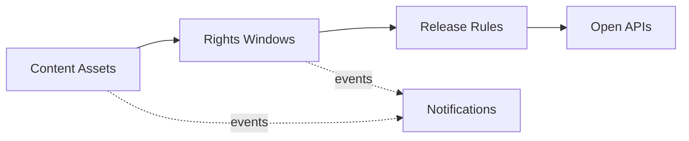

# Domain Model and Bounded Contexts

Ubiquitous language and context design (view VP-4). Domain-standard concepts are mapped
normatively in `../domain/domain-standards.md` (CR-5).

## Ubiquitous language (selected terms)

| Term | Meaning |
|---|---|
| **Content asset** | A film, series, music or live-event asset; its registry code is masked |
| **Rights window** | A title's guarded licensed-units account for distribution |
| **Distribution use** | One use of a title on a channel (streaming, broadcast, theatrical, airline) |
| **Release rule** | A decision rule binding a territory group to release and incident envelopes |
| **Programming slot** | A scheduled prime-time, daytime or late-night slot |
| **Piracy risk score** | A transparent 0-100 leak/piracy risk score |

## Bounded contexts and invariants

### Content Assets — `content-service`
Content asset registry; the registry code is masked at registration. Lifecycle: `DRAFT` → transitions
publish, archive. Audience personal data stays in adopter platforms; this core manages content, rights and schedules. Content identifiers are internal or registry codes; all data is synthetic.

### Rights Windows — `rights-service`
Guarded licensed-units accounts per title and the distribution uses against them. **Invariant (ADR-0004): distribution uses against a title's licensed units never exceed the license — a use that would overrun the licensed units is rejected (422) and records nothing; rights are never silently exceeded.** Consumption records are
append-only evidence; a rejected operation records nothing.

### Release Rules — `release-rules-service`
Decision rules binding territory groups to release-volume and piracy-incident envelopes. Only ACTIVE rules decide; evaluation order is by priority; every decision
is ALLOWED / DEGRADED / DENIED with the matched rule and a human-readable reason.

### Programming Slots — `programming-service`
Programming slot catalogue for schedules.

### Notifications — `notification-service`
Delivery trail for audit; recipients are never logged.

## Context map

